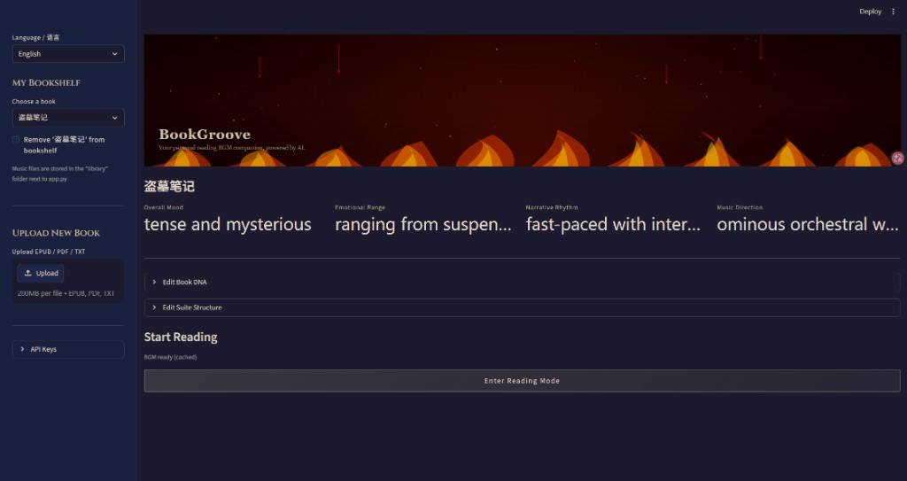
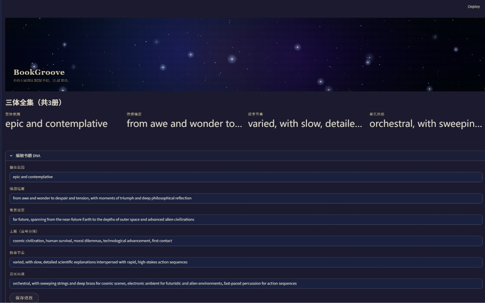
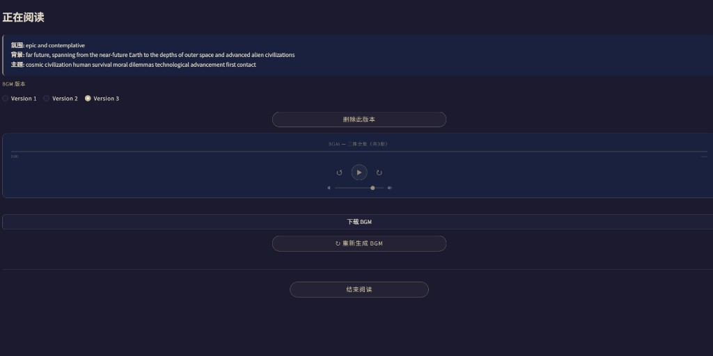
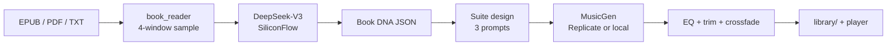

# BookGroove

Most AI music demos try to *impress* you. BookGroove tries **not to**.

It is a reading companion by **ZHOU SIHAN**: you give it a book, it listens for atmosphere, then writes a **three-movement instrumental suite** that can loop in the background while you actually read. The music should stay behind the page — one clear line, sparse accompaniment, no drums competing with your attention.

> One book → one DNA → one suite. Not a playlist. Not per-chapter scoring.

<p align="center">
  
</p>
<p align="center"><em>Bookshelf — four DNA fields, then enter reading when a suite is cached.</em></p>

<p align="center">
  
</p>
<p align="center"><em>Book DNA is a brief you can edit before spending generation credits.</em></p>

<p align="center">
  
</p>
<p align="center"><em>Reading mode — loop the suite, switch versions, download.</em></p>

---

## Why this exists

Reading with random lo-fi or a movie soundtrack usually fails in one of two ways: it is too generic, or it is too dramatic. A book has a *register* — melancholic and cyclical, tense and urban, ceremonial and slow — that a single loop rarely matches.

BookGroove treats that register as data:

1. Sample the book (beginning, early-middle, mid, late — not only chapter one).
2. Compress it into a **Book DNA**: mood, emotional range, themes, setting, narrative rhythm, music direction.
3. Compose **exactly three movements** that share a key, a lead instrument, and a short motif (Opening → Development → Finale).
4. Generate each movement with **MusicGen**, then stitch them with silence-trim + crossfade so the suite feels like one piece.

You can edit the DNA and the three prompts *before* you spend generation credits. That is intentional: the interesting work is the brief, not the button.

A fictional DNA example lives in [`examples/sample_book_dna.json`](examples/sample_book_dna.json).

---

## What it does (concretely)

| Step | What happens |
|------|----------------|
| Parse | EPUB (spine + HTML), PDF (text layer), or TXT. ~8000 characters sampled in four windows. Scanned PDFs are rejected, not OCR’d. |
| Analyze | DeepSeek-V3 on SiliconFlow returns JSON DNA. Retries on 503 / “system busy”. |
| Design | A second LLM pass writes three MusicGen prompts: one lead + optional pad, 55–65 bpm, **no percussion**, shared key and motif. |
| Generate | Replicate `meta/musicgen` (`melody-large` by default), ~40s per movement. Optional local `facebook/musicgen-medium`. |
| Finish | EQ (cut kick rumble, lift presence), peak-normalize, trim leading/trailing silence, 4s crossfade, fade in/out. Saved as `library/<book>/bgm_vN.mp3`. |
| Read | Custom loop player, version switch, download. Switching books **leaves** reading mode so the previous BGM cannot fake itself onto a new title. |

The UI is Streamlit: dark “library lamp” theme, EN/CN copy, and a canvas hero scene that guesses genre from DNA keywords (fog, ink-wash, neon, dusk…).

---

## Design decisions (the actual project)

**Not per-chapter BGM.** Chapter boundaries are not emotion boundaries. Generating N tracks for N chapters is expensive and interrupts reading. A 3-movement arc is the product.

**MusicGen only.** A second cloud model (Stable Audio) was prototyped on the same Replicate token, then removed. One engine, one mental model: prompt → wav → stitch.

**`melody-large` + post-process, not “larger = better”.** MusicGen Large tends to fill the mix — ghost drums, muddy mids. The reading path uses `melody-large`, `peak` normalization (so faint noise is not pumped up), a high-pass around 90 Hz, a light 200 Hz cut, and a presence boost around 2.8 kHz. Prompts are constrained to a singable 4–8 note motif and two layers max.

**Stitching has to fight silence.** Model outputs often start/end with dead air. Crossfading *that* sounds like a hole in the suite. Tracks are trimmed to audible content first.

**The human stays in the loop.** DNA and suite prompts are first-class UI, not hidden logs.

---

## Architecture



Two paid APIs, nothing else:

| API | Key | Role |
|-----|-----|------|
| [SiliconFlow](https://cloud.siliconflow.cn) | `OPENAI_API_KEY` | DNA + suite text (OpenAI-compatible SDK, `https://api.siliconflow.cn/v1`) |
| [Replicate](https://replicate.com/account/api-tokens) | `REPLICATE_API_TOKEN` | MusicGen audio (`https://api.replicate.com/v1`) |

---

## Stack

Python 3.10+ · Streamlit · BeautifulSoup / pypdf · pydub + ffmpeg (`static-ffmpeg`) · DeepSeek-V3 · Meta MusicGen

```
app.py                 UI (bookshelf, DNA, player)
core/analyzer.py       Prompts + SiliconFlow client (retries)
core/generator.py      MusicGen, EQ, silence trim, stitch
core/bgm_workflow.py   One generation pipeline for first run and regen
core/book_reader.py    EPUB / PDF / TXT
core/cache.py          library/ DNA + bgm_vN versions
core/scene.py          Optional hero canvases
core/strings.py        EN / CN
```

---

## Run it

```bash
pip install -r requirements.txt
cp .env.example .env   # Windows: copy .env.example .env
```

Fill in:

```env
OPENAI_API_KEY=sk-...           # SiliconFlow
REPLICATE_API_TOKEN=r8_...      # Replicate
USE_LOCAL_MODEL=false
MUSICGEN_MODEL_VERSION=melody-large
```

```bash
streamlit run app.py
```

Windows: `run.bat`. Local GPU MusicGen: `setup_local.bat`, then `USE_LOCAL_MODEL=true` (first run ~3 GB into `models/`).

Never commit `.env` or `library/` audio. Both are gitignored.

---

## What this is not

- Not a music DAW, not Suno/Udio song mode, not a full EPUB reader.
- Prompts **ask** for instrumental / no drums; MusicGen can still leak a pulse. Post-processing reduces it; it does not guarantee silence in the rhythm band.
- SiliconFlow can return 503 at peak hours; Replicate downloads can SSL-timeout on some networks. The client retries; a proxy may still be required.
- Image-only PDFs will not work.

Code is [MIT](LICENSE) © 2026 **ZHOU SIHAN**. MusicGen weights are typically CC-BY-NC — see [NOTICE.md](NOTICE.md).

---

## 中文

BookGroove 不是「再做一个 AI 作曲玩具」，而是给**正在读书的人**写背景乐。

一本书只对应一套三乐章纯音乐：同一调性、同一主奏乐器、同一短动机，从开端走到收束，然后循环。不做按章切歌——章节边界不等于情绪边界，切来切去只会打断阅读。

具体路径：四段采样全书 → 硅基流动 DeepSeek-V3 抽出 Book DNA（氛围、情感幅度、主题、节奏、音乐方向）→ 再写成三段 MusicGen prompt（主旋律 + 一层轻垫，55–65 bpm，明确禁止鼓组）→ Replicate 上的 MusicGen 出音 → 均衡、裁掉首尾静音、交叉淡入淡出。DNA 和乐章都可以在花钱生成之前改。

试过第二个云端模型（Stable Audio），最后只保留 MusicGen，避免作品叙事分裂。后处理针对的是真实听感：Large 容易糊、暗处像有鼓；现在默认 `melody-large`，压低频 rumble，把主旋律所在频段抬清楚一点。

克隆后请自己准备硅基流动和 Replicate 的 Key。不要把 `.env` 和生成音频推到 GitHub。

作者：**ZHOU SIHAN**
